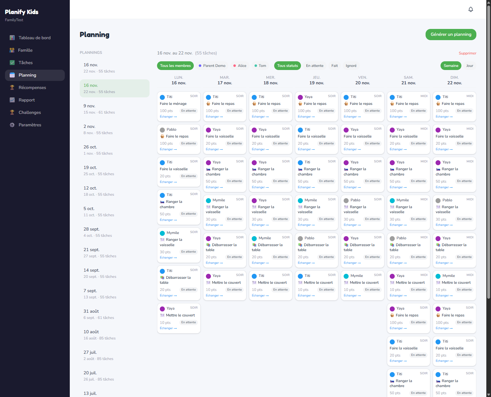
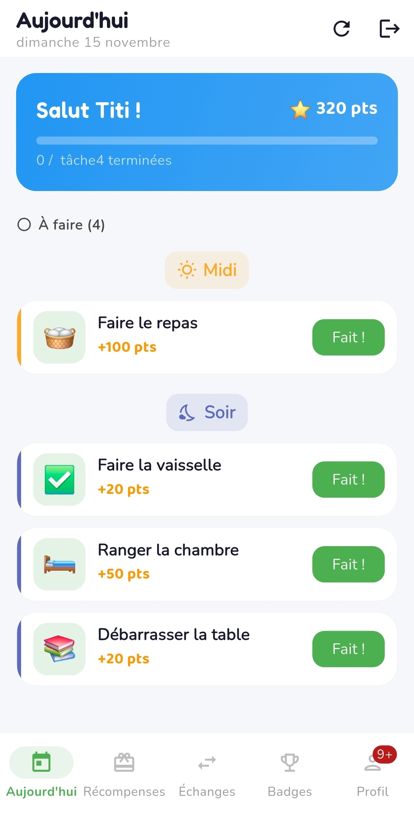
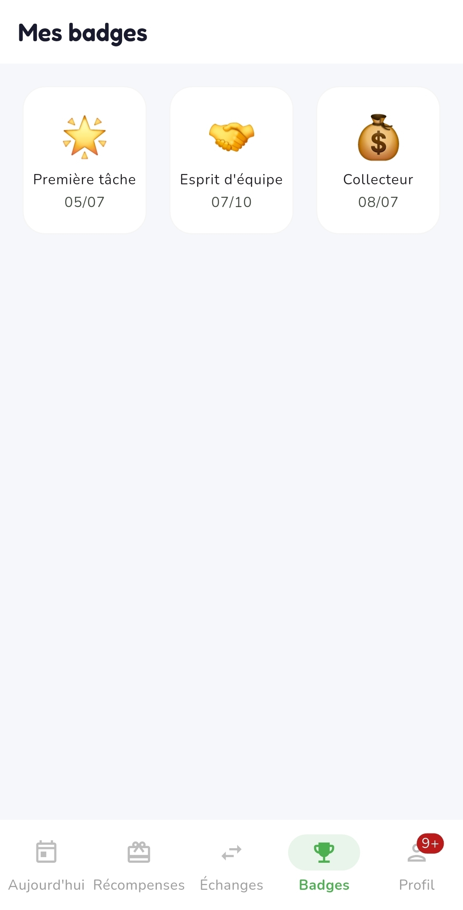

# Planify Kids

**Application familiale de planification des tâches ménagères : un espace web pour les parents, une application tablette pour les enfants.**

Planify Kids répartit équitablement les tâches de la maison entre parents et enfants, et donne envie aux enfants de les faire grâce aux points, badges, récompenses et défis familiaux. Projet personnel conçu et développé seul, de l'analyse du besoin à la mise en production, et utilisé au quotidien par ma famille.

🔗 **Démo en ligne :** [planify-kids-api.vercel.app](https://planify-kids-api.vercel.app)
Compte de démonstration : `demo@planify.kids` / `demo1234` (données partagées, susceptibles d'être réinitialisées)

---

## Aperçu

| Espace parent (web) : planning de la semaine |
| :---: |
|  |

| Tablette enfant : tâches du jour | Tablette enfant : badges |
| :---: | :---: |
|  |  |

---

## Fonctionnalités

### Planning automatique et équitable
- Génération du planning hebdomadaire avec **rotation des tâches d'une semaine à l'autre** (historique de charge sur 28 jours glissants).
- **Répartition 80/20** entre enfants et parents, pondérée par les points de chaque tâche.
- Créneaux **midi + soir** les week-ends, vacances et jours fériés, **soir seul** les jours d'école, d'après le calendrier scolaire officiel (API publiques `calendrier.api.gouv.fr` et `data.education.gouv.fr`, zones A/B/C et DOM-TOM).

### Espace parent (web)
- Gestion de la famille, des tâches, des récompenses et des défis familiaux.
- Planning filtrable par membre et par statut, en vue semaine ou jour.
- Tableau de bord et rapport hebdomadaire par enfant, historique (timeline) de chaque enfant.
- Validation des demandes de récompenses, mises à jour en temps réel (SSE).
- Application web installable (PWA), interface français / anglais.

### Application enfant (tablette Android)
- Connexion par code famille + PIN (le PIN peut être désactivé par le parent pour les plus jeunes).
- Tâches du jour, points, récompenses, badges (paliers de points, séries de jours consécutifs, défis réussis).
- **Échange de tâches entre frères et sœurs par glisser-déposer.**
- Animations de célébration (confettis, « +N pts », fenêtre « Nouveau badge ! »).
- Planning mural de toute la famille.
- **Fonctionnement hors ligne** : lecture et écriture sans réseau, synchronisation au retour de la connexion, avec une règle de résolution des conflits (le serveur fait foi).

### Notifications
- Notifications in-app et push (Firebase Cloud Messaging) : tâches attribuées, badge gagné, rappel du matin et tâches oubliées le soir, envoyés **à l'heure locale de chaque famille**.

---

## Stack technique

| Couche | Technologies |
| --- | --- |
| Web parent | React 19, TypeScript, Vite, Tailwind CSS v4, shadcn/ui, React Router v7, TanStack Query, Zustand, react-i18next |
| Mobile enfant | Flutter (Dart), Riverpod, PowerSync (SQLite local + synchronisation), Firebase Messaging |
| API | Node.js, Hono, Zod, JWT + Argon2, node-cron |
| Données | PostgreSQL (Supabase) via Prisma 7, MongoDB (journaux d'activité et analytics) |
| Qualité | Vitest (tests unitaires API et web), Playwright (tests E2E), tests widget Flutter, TypeScript strict |
| DevOps | Monorepo pnpm, Docker (images multi-stage), GitHub Actions, Vercel (web + API serverless + cron jobs), Sentry |

## Architecture

```
planify-kids/
├── apps/
│   ├── api/       # API REST Hono : modules (auth, family, tasks, planning, rewards, exchanges…)
│   │              # Controller → Service → Repository → Prisma, validation Zod à chaque entrée
│   ├── web/       # Espace parent React (features/, components/, services/, store/)
│   └── mobile/    # Application enfant Flutter
├── packages/
│   └── types/     # Types TypeScript partagés entre l'API et le web
├── api/           # Point d'entrée serverless Vercel
├── docker/        # Dockerfiles API et web
└── scripts/       # Environnement de développement Docker
```

Principes : architecture en couches, multi-tenant par `familyId` sur toutes les tables, sécurité RLS activée sur la base Supabase, tests unitaires sur la logique métier (génération du planning, gamification, calendrier scolaire).

---

## Lancer le projet en local

### Prérequis
- Node.js ≥ 24 et pnpm ≥ 10
- Docker (pour PostgreSQL et MongoDB en local)
- Flutter SDK (uniquement pour l'application mobile)

### Option 1 : tout avec Docker (recommandé)

```bash
git clone https://github.com/Paul-Sebas-Pro/planify-kids.git
cd planify-kids
./scripts/docker-dev.sh --build --seed
```

Le script démarre PostgreSQL, MongoDB, l'API (port 3000) et le web (port 5173), puis insère les données de démonstration. `./scripts/docker-dev.sh --help` liste les autres options.

### Option 2 : sans Docker pour l'API et le web

```bash
pnpm install
cp .env.example .env          # renseigner DATABASE_URL, MONGODB_URI, JWT_SECRET
pnpm --filter @planify-kids/api db:push
pnpm --filter @planify-kids/api db:seed
pnpm dev                      # API (:3000) + web (:5173)
```

### Application mobile

```bash
cd apps/mobile
flutter pub get
flutter run --dart-define=API_BASE_URL=http://10.0.2.2:3000
```

### Tests

```bash
pnpm test                               # tests unitaires (API + web)
pnpm typecheck
pnpm --filter @planify-kids/web e2e     # tests E2E Playwright
cd apps/mobile && flutter test          # tests widget Flutter
```

---

## Déploiement

Chaque push sur `main` lance la CI GitHub Actions (typecheck, tests, tests E2E) et un déploiement automatique sur Vercel : le web en site statique, l'API en fonction serverless, et les tâches planifiées en Vercel Cron Jobs. L'application Android est distribuée en APK sur les tablettes de la famille.

---

## Auteur

**Paul SEBAS** : Concepteur Développeur d'Applications
[LinkedIn](https://www.linkedin.com/in/paul-sebas-pro) · [GitHub](https://github.com/Paul-Sebas-Pro)
